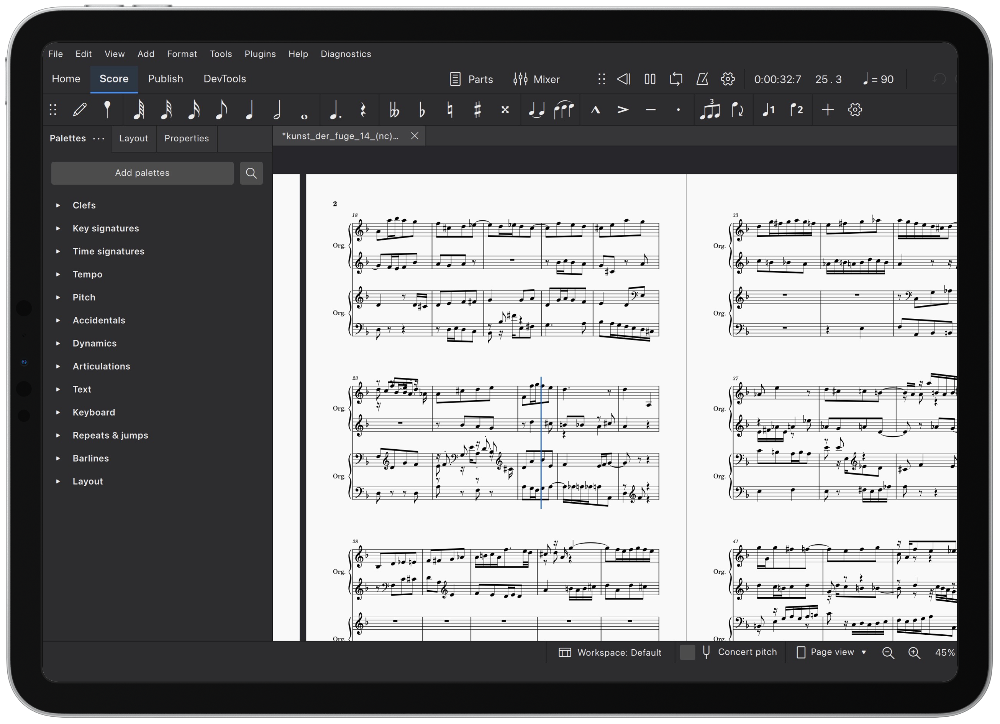

  

# CantoForge

**An unofficial iPadOS port of MuseScore Studio 4.7.5**, retaining the desktop
interface and core music notation features.

CantoForge is an independent community project. It is **not affiliated with
or endorsed by MuseScore or Muse Group**, and is not the official MuseScore
mobile application.

  

*CantoForge running on iPad, with the familiar MuseScore Studio desktop interface.*

## Download and install

Download the unsigned IPA from [Releases](https://github.com/Jinketomy-Masheldia/CantoForge/releases).
The first release is **v0.1.0-alpha.1**, an experimental pre-release.
The port release number is separate from the upstream Studio version and the
iPad app's bundle build number.

The `ipad-port` branch also contains newer, unreleased input improvements,
including dragging selected score elements and slur/tie grips with a finger.
These are not included in the existing `v0.1.0-alpha.1` IPA.
See [the changelog](CHANGELOG.md) for the current source changes.

Sign and install the IPA using your own compatible sideloading workflow, such
as SideStore or AltStore. Signing credentials are not included. No App Store
release is planned at present.

- App name: **CantoForge**
- Bundle identifier: **com.jmx.cantoforge**
- Configured target: **arm64 iPads, iPadOS 17.0 or later**
- Reported test device: **11-inch iPad Pro (2022, M2)**, with iPadOS 26.6 as
  reported by its owner. Other devices and OS versions are not established
  as tested.

The bundle identifier differs from the older personal development builds.
CantoForge may install as a separate application. Export or back up scores
before removing an older version. Use copies of important scores while
trying this experimental port.

## Features and limitations

| Area | Status |
| --- | --- |
| Desktop interface and notation editor | Retained; many workflows reported usable on the test iPad |
| Score creation, preferences and export dialogs | iPad platform fixes included |
| Playback | CoreAudio output with bundled MS Basic and FluidR3Mono SoundFonts |
| Audio export | Apple AudioToolbox AAC-LC/ADTS backend; other retained desktop formats depend on the available exporters |
| Files integration | Document import, local score storage and file sharing |
| Touch input | Score panning, tap selection, selected element/grip dragging, panel scrolling, long-press context menus and touch-aware submenus; newest changes are currently source-only |
| External mouse and keyboard | Desktop input retained, with an iPad secondary-click bridge |
| Import/export formats | Core modules retained; every format has not been verified on iPad |
| Languages | Upstream translations retained; new CantoForge text translated into Simplified and Traditional Chinese, with English fallback elsewhere |

MuseSounds/MuseSampler, desktop VST plug-ins, the desktop updater, subprocess
multiwindow support, cloud integration, automation and video export are
disabled in the iPad configuration. Cloud save and publishing controls are
disabled. Experimental MNX import/export is disabled by the build helper.
Script/QML extensions are retained, but external-process APIs are unavailable.

Portrait layouts, multitasking, Apple Pencil, accessibility, printing,
larger-score performance and accessory-specific behavior need further testing.
This is not a claim of complete feature or device compatibility.

Panel ordering is adjusted with a mouse. On touch, vertical swipes scroll the
panels; drag a palette symbol horizontally first to move it onto the score.

## Build from source

Build on macOS with Xcode, CMake, Ninja, matching **Qt 6.11.2 iOS/macOS kits**,
and **HarfBuzz 12.3.0 sources**. Development used the iPhoneOS 26.5 SDK.

See [build and installation instructions](docs/ios-port.md).
The `ipad-port` branch is based on upstream `v4.7.5` commit
`3654226c2e99289916916953a98e585a3d3b315a`, preserving upstream Git history.
The framework and vendored dependencies for this baseline are in-tree;
the later upstream development branch's submodules are not required.

Each binary release includes matching application and dependency source
materials, build information, license notices and checksums. Qt is statically
linked; the automatic GitHub source ZIP alone does not include the separately
installed Qt sources. See [release preparation](docs/releasing.md).

## Privacy and feedback

Scores and diagnostic logs are stored on your device. Online learning content
uses network connections, and external websites are subject to their providers'
privacy policies. Local logs can contain score filenames and paths; review
logs before sharing them publicly.

Report port-specific issues in [this repository's Issues](https://github.com/Jinketomy-Masheldia/CantoForge/issues).
Include the app build number, iPad model, iPadOS version, input device and steps
to reproduce the problem. Logs are available through Files in the application's
Documents directory. See [the manual testing guide](docs/testing.md).

Do not send port-only issues to the upstream team as official Studio bugs.
If a problem also occurs in official desktop Studio, mention that in the report.

## Licensing and acknowledgements

CantoForge derives from MuseScore Studio under **GNU GPL version 3**, with the
existing upstream font exception. See [LICENSE.txt](LICENSE.txt) and
[provenance and notices](NOTICE.md). Original copyright notices are retained.
Third-party libraries, fonts and SoundFonts retain their individual licenses.

- [MuseScore Studio source](https://github.com/musescore/MuseScore)
- [MuseScore.org](https://musescore.org/)
- [Original upstream README](docs/upstream/README.md)

MuseScore Studio contributors, Qt and the bundled dependency authors provide
the editor, engraving engine and other foundations of this port. Upstream
manual, tutorial and forum links remain available as upstream resources.
Project names and trademarks belong to their respective owners.

The CantoForge logo was supplied by the maintainer. Substantial port and
documentation work was developed with assistance from **OpenAI Codex**, informed
by build/runtime checks and the maintainer's device feedback.

Bug reports, device testing, documentation fixes and focused patches are welcome.
See [CONTRIBUTING.md](CONTRIBUTING.md) and [CODE_OF_CONDUCT.md](CODE_OF_CONDUCT.md).
